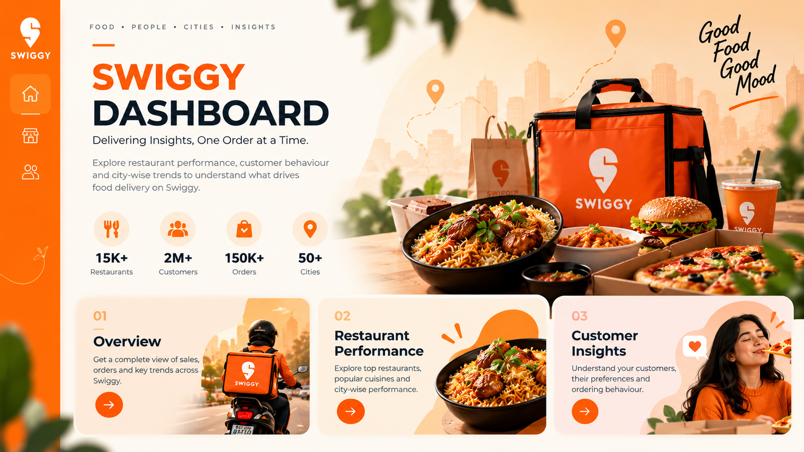
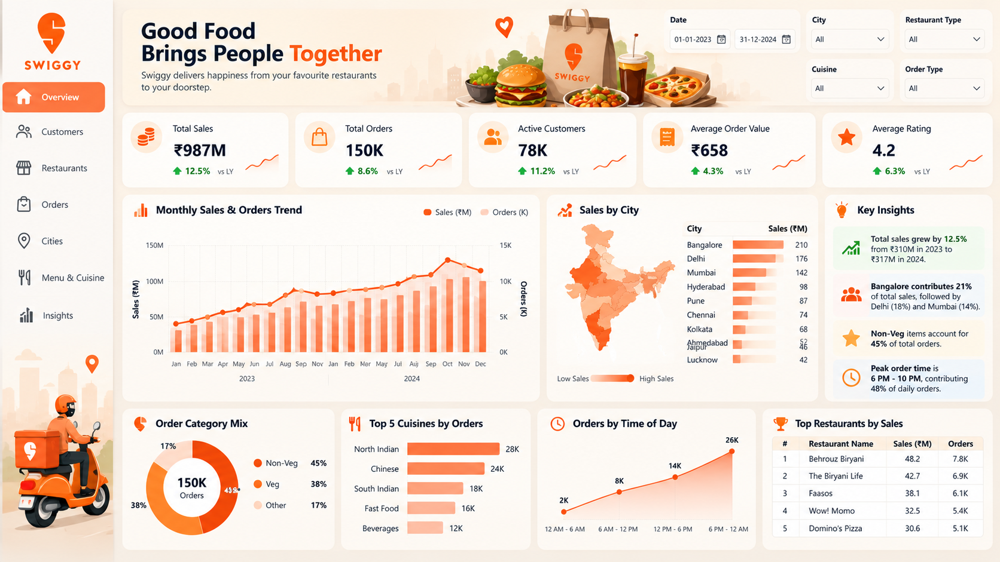
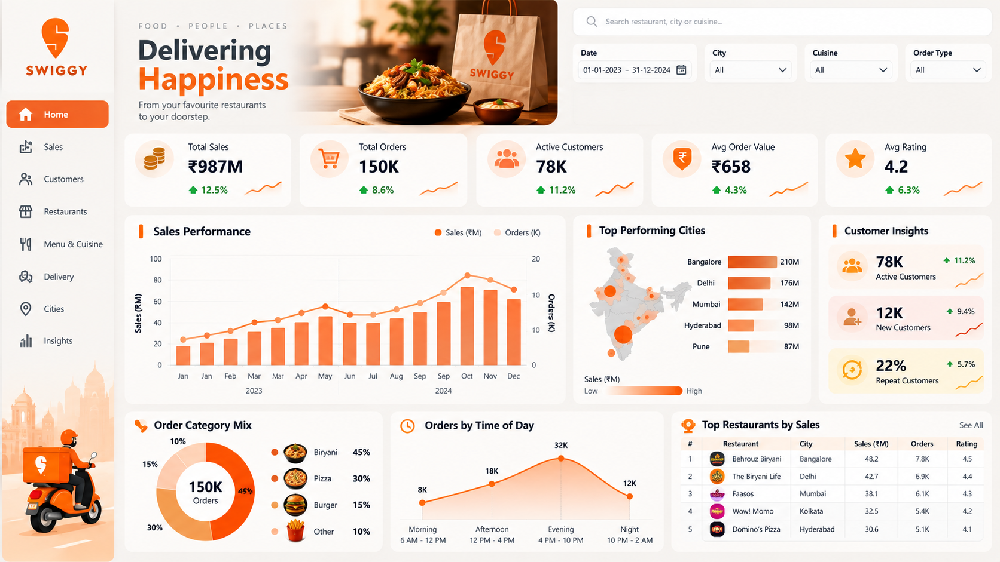
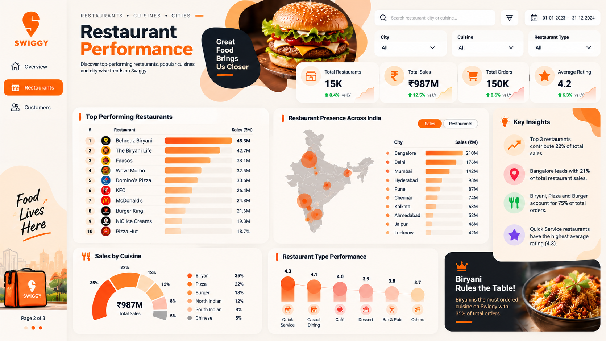
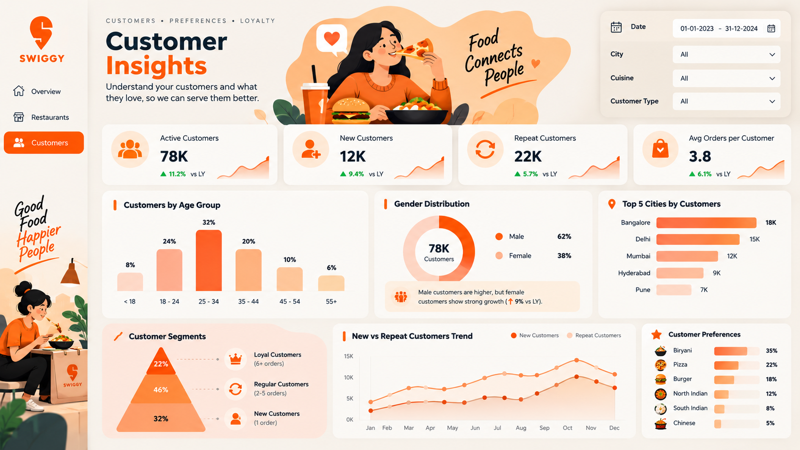
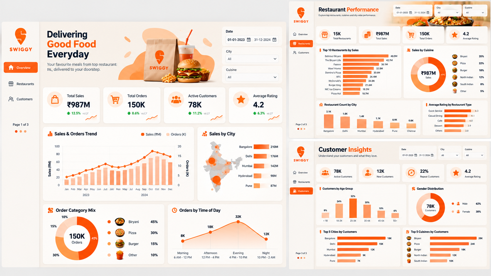
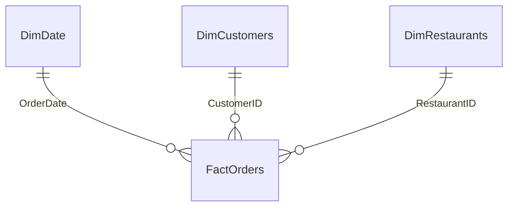

<div align="center">

# 🍽️ Swiggy Food Analytics Dashboard

**An interactive Power BI dashboard analysing sales, orders, restaurants and customers for a food delivery platform.**


### 🔗 [**View the Live Interactive Dashboard**](https://app.powerbi.com/view?r=eyJrIjoiNzUxMjUzNDUtZmQ4ZC00ZjQwLWI1ODctODU3Y2RhNzZkOWRlIiwidCI6ImM5YzUwODQ4LWIwM2EtNGJlNC1iNjU1LTZlZGQ3ZmI4MWM1YSJ9)

[](https://app.powerbi.com/view?r=eyJrIjoiNzUxMjUzNDUtZmQ4ZC00ZjQwLWI1ODctODU3Y2RhNzZkOWRlIiwidCI6ImM5YzUwODQ4LWIwM2EtNGJlNC1iNjU1LTZlZGQ3ZmI4MWM1YSJ9)

</div>

---

## 📑 Table of Contents

1. [Project Overview](#-project-overview)
2. [Business Problem](#-business-problem)
3. [Dashboard Pages](#-dashboard-pages)
4. [Key Insights](#-key-insights)
5. [Dataset & Data Model](#%EF%B8%8F-dataset--data-model)
6. [KPI Definitions](#-kpi-definitions)
7. [Tools & Technologies](#%EF%B8%8F-tools--technologies)
8. [Repository Structure](#-repository-structure)
9. [How to Use](#-how-to-use)
10. [Author](#-author)

---

## 🎯 Project Overview

This project is a **Swiggy Food Analytics Dashboard** built in **Power BI**. It helps a food delivery business understand what drives its sales by looking at:

- **Sales and orders** over time, by city, cuisine and time of day
- **Restaurant performance**: top restaurants, cuisine mix and restaurant types
- **Customer behaviour**: age, gender, new vs. repeat customers and preferences

The dataset covers **150,000 orders**, **78,000 customers** and **15,000 restaurants** from **January 2022 to May 2026**. The dashboard screenshots use a **01-01-2023 to 31-12-2024** date range, and every page can be filtered by **Date, City, Cuisine, Restaurant Type / Order Type**.

## ❓ Business Problem

Food delivery platforms generate large amounts of order data, but teams still need clear answers to questions like:

- How are **sales and orders** trending, and which **cities** lead?
- Which **restaurants and cuisines** bring in the most revenue?
- Who are the **customers**, and how many of them come back?
- At what **time of day** do customers order the most?

This dashboard brings these answers into one interactive report.

---

## 📊 Dashboard Pages

### 🏠 Landing Page
Entry page with headline numbers (15K+ restaurants, 2M+ customers, 150K+ orders, 50+ cities) and navigation to the report pages.


### 1️⃣ Overview
Total sales, total orders, active customers, average order value and average rating, with a monthly sales and orders trend, sales by city, order category mix, top cuisines, orders by time of day and top restaurants.



**Alternate overview layout**



### 2️⃣ Restaurant Performance
Top 10 restaurants by sales, sales by cuisine, restaurant presence across India, restaurant type performance, and key insights.



### 3️⃣ Customer Insights
Active, new and repeat customers, customers by age group, gender split, top cities, customer segments (Loyal / Regular / New), new vs. repeat trend and cuisine preferences.



### 🖼️ All Pages at a Glance



---

## 💡 Key Insights

Figures below are read from the dashboard screenshots (date range 01-01-2023 to 31-12-2024).

| Area | Insight |
|------|---------|
| **Scale** | **₹987M** total sales from **150K orders**, **78K active customers** and **15K restaurants**, with an average rating of **4.2**. |
| **Top cities** | Bangalore leads with **₹210M (21% of sales)**, followed by Delhi (₹176M) and Mumbai (₹142M). |
| **Cuisines** | Biryani is the most ordered cuisine at **35%**, followed by Pizza (22%) and Burger (18%). |
| **Restaurants** | Behrouz Biryani is the top restaurant by sales (**₹48.3M**), followed by The Biryani Life and Faasos. The top 3 contribute about 22% of sales. |
| **Restaurant types** | Quick Service restaurants have the highest average rating (**4.3**). |
| **Peak hours** | Orders peak in the evening, between 4 PM and 10 PM. |
| **Customers** | **12K new** customers and **22%** repeat customers. Customers aged **25–34** are the largest group (32%), and **62%** of customers are male. |

---

## 🗄️ Dataset & Data Model

The dataset is in [`data/Swiggy_PowerBI_Dataset_Jan2022_May2026.xlsx`](data/Swiggy_PowerBI_Dataset_Jan2022_May2026.xlsx) and follows a **star schema** with one fact table and three dimension tables, plus a monthly summary.

| Table | Rows | Description |
|-------|-----:|-------------|
| `FactOrders` | 150,000 | One row per order: date, city, cuisine, restaurant type, order type, payment mode, status, sales, discount, fees, tax, rating and delivery minutes |
| `DimRestaurants` | 15,000 | Restaurant name, city, cuisine, type, rating, opening date and active flag |
| `DimCustomers` | 78,000 | Signup date, age group, gender, home city, preferred cuisine and customer segment |
| `DimDate` | 1,612 | Calendar table with year, quarter, month, weekday and weekend flag |
| `MonthlySummary` | 53 | Pre-aggregated monthly orders, sales, order value, quantity and average rating |

### Data model



Column-level details and data notes are in [`docs/data_dictionary.md`](docs/data_dictionary.md).

---

## 📐 KPI Definitions

| KPI | Definition |
|-----|-----------|
| **Total Sales** | Sum of `NetSales` |
| **Total Orders** | Count of `OrderID` |
| **Active Customers** | Distinct count of `CustomerID` with orders in the selected period |
| **Average Order Value** | Sales divided by total orders |
| **Average Rating** | Average of `Rating` |
| **Total Restaurants** | Distinct count of `RestaurantID` |
| **New Customers** | Customers in the `New` segment of `DimCustomers` |
| **Repeat Customers** | Customers who ordered more than once in the selected period |
| **Avg Orders per Customer** | Total orders ÷ active customers |

The dataset's `CustomerSegment` column has three values: **New**, **Regular** and **Repeat**. The dashboard's segment visual shows Loyal / Regular / New tiers; adjust the definitions to match your DAX. See [`docs/kpi_definitions.md`](docs/kpi_definitions.md).

---

## 🛠️ Tools & Technologies

- **Power BI Desktop**: data modelling, DAX measures, report design
- **Power Query**: data loading and transformation
- **DAX**: KPIs and time intelligence
- **Microsoft Excel**: source dataset
- **Power BI Service**: publishing and live sharing

---

## 📁 Repository Structure

```
swiggy-food-analytics-dashboard/
│
├── README.md
├── LICENSE
├── .gitignore
│
├── assets/
│   └── screenshots/
│       ├── 00_landing_page.png
│       ├── 01_overview.png
│       ├── 02_overview_home_alt.png
│       ├── 03_restaurant_performance.png
│       ├── 04_customer_insights.png
│       └── 05_all_pages_overview.png
│
├── data/
│   └── Swiggy_PowerBI_Dataset_Jan2022_May2026.xlsx
│
└── docs/
    ├── data_dictionary.md
    └── kpi_definitions.md
```

---

## 🚀 How to Use

1. **View online:** open the [live dashboard](https://app.powerbi.com/view?r=eyJrIjoiNzUxMjUzNDUtZmQ4ZC00ZjQwLWI1ODctODU3Y2RhNzZkOWRlIiwidCI6ImM5YzUwODQ4LWIwM2EtNGJlNC1iNjU1LTZlZGQ3ZmI4MWM1YSJ9) and use the filters on each page.
2. **Explore the data:** clone the repo and open the Excel file.
   ```bash
   git clone https://github.com/<your-username>/swiggy-food-analytics-dashboard.git
   cd swiggy-food-analytics-dashboard
   ```
3. **Rebuild in Power BI Desktop:** choose *Get Data → Excel*, load all sheets, and relate `FactOrders` to `DimDate`, `DimCustomers` and `DimRestaurants` as shown above.

---

## 👤 Author

**Your Name**

- GitHub: https://github.com/IshwariAttarde
- LinkedIn: https://www.linkedin.com/in/ishwariattarde/

⭐ If you found this project useful, please give it a star!

---

> *Swiggy is a registered trademark of its respective owner. This is an independent portfolio project built on a sample dataset and is not affiliated with or endorsed by Swiggy.*
